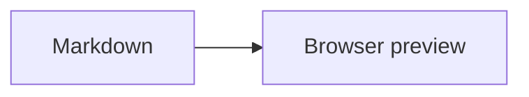

# Write Markdown for docserve

Follow the target repository's document and asset conventions.

## Write the document

Resolve the output path, audience, language, and source material from the request
and repository context. Inspect an existing document before editing it.

If `$asd-ste100` is available, use it for English technical text. Use Strict mode
for procedures and agent instructions. Use STE-flavored mode for explanations.
Preserve the requested language, identifiers, quotations, and strength of claims.
Creative and marketing text follow the user's requested voice.

Use relative links for local documents and assets. Use HTTPS links for external
sources. Keep machine-local paths out of the document's links.

## Add visuals when useful

- Use tables for compact comparisons and mappings.
- Use fenced `mermaid` blocks for flows, sequences, states, and relationships.
- Use external SVG for custom diagrams. Store assets beside the document using
  the repository's convention, or `<document-stem>-assets/` when none exists.
- Use inline SVG when a small visual or a single-file deliverable calls for it.
  Start `<svg>` on its own line. Include `viewBox` and the SVG namespace.

Reference external SVG with meaningful alt text:

```markdown

```

Keep SVG declarative. The viewer sanitizes HTML and removes style attributes.
Use SVG presentation attributes such as `fill` and `stroke` for inline visuals.

Keep Mermaid diagrams small and legible. Use simple node identifiers and quote
labels when necessary:

````markdown

````

Use commas in sequence-diagram messages. Mermaid treats semicolons as statement
separators. Leave diagram rendering to the viewer.

## Write equations

Use `$...$` for inline math and `$$` on separate lines for display math.
The viewer uses KaTeX. Keep TeX command backslashes single:

```markdown
Inline math: $E = mc^2$

$$
\int_0^\infty e^{-x^2}\,dx = \frac{\sqrt{\pi}}{2}
$$
```

When revising math intended for this viewer, convert parenthesis or bracket
delimiters to dollar delimiters. Preserve the expression and its display mode.
Math inside code remains literal.

## Validate and deliver

Resolve `skill_dir` to this skill's directory. Set `output_file` to each created
or changed Markdown file. Run the source validator:

```bash
python -B "$skill_dir/scripts/check_markdown.py" "$output_file"
```

For files with Mermaid diagrams, also run:

```bash
docserve-check mermaid "$output_file" --render --json
```

The command uses docserve's packaged viewer and checks each diagram in light
and dark themes with headless Chromium. Fix document errors and repeat the check.
Exit 1 means a diagram failed; exit 2 means a usage or environment error. Report
missing dependencies or timeouts as incomplete validation and include the command's
setup instructions. Checks never install dependencies automatically.

For a syntax-only check, omit `--render`. Report that result as syntax validation.
A render pass proves viewer completion and visible SVG output; inspect layout
separately when clipping, overlap, or readability matters. Files with no Mermaid
blocks are reported explicitly. The command accepts multiple Markdown files.
See [checker setup and guarantees](https://github.com/vimkim/docserve/blob/main/docs/guide.md#mermaid-checks).

Keep the Markdown source check separate. Validate relative asset links and the
final diff. Keep validation results separate from viewing instructions.

Use `$serve-docs` to provide the viewing command.
